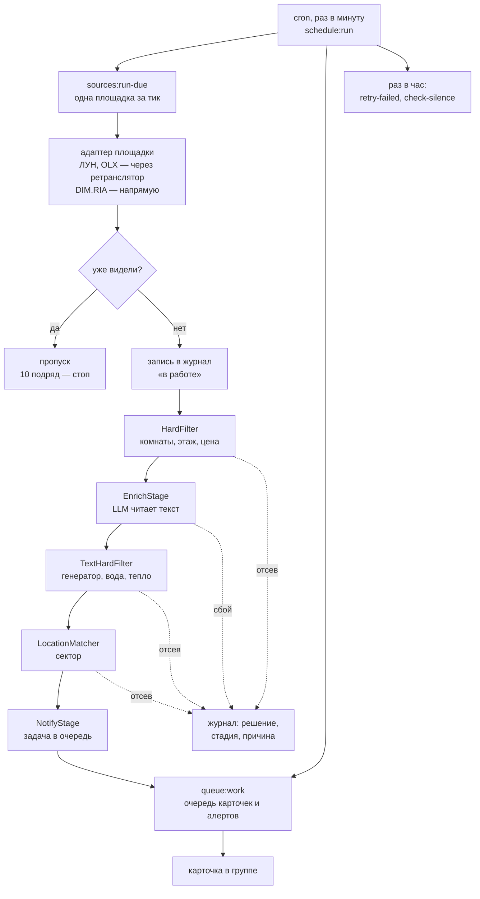

# Жизненный цикл приложения

Как объявление проходит путь от площадки до карточки в Telegram и что работает вокруг этого пути. Описание сверено с кодом; у каждого шага — класс или файл, где он живёт. Решения и их причины — в [CLAUDE.md](../CLAUDE.md), факты о хостинге — в [hosting.md](hosting.md), команды — в [COMMANDS.md](COMMANDS.md).

## 1. Время: cron и планировщик

На хостинге нет долгоживущих процессов (shared-хостинг, лимиты LVE), поэтому всё работает короткими запусками. Cron в cPanel раз в минуту вызывает `schedule:run` ([docs/COMMANDS.md](COMMANDS.md) → строка cron); в dev то же делает supercronic в контейнере `scheduler` ([docker/php/crontab](../docker/php/crontab)).

Расписание — [routes/console.php](../routes/console.php):

| Когда | Команда | Что делает |
|---|---|---|
| каждую минуту | `sources:run-due` | опрашивает одну площадку, если ей пора |
| каждую минуту | `queue:work --stop-when-empty --max-time=50` | отправляет карточки и алерты из очереди и завершается |
| в :15 каждого часа | `sources:check-silence` | алерт, если площадка сутки не приносит новых объявлений |
| в :30 каждого часа | `listings:retry-failed` | повторяет LLM для объявлений со «Сбоем» |

У задач `withoutOverlapping(5)`: если прошлый запуск ещё идёт, новый не стартует; замок живёт не дольше 5 минут, даже если процесс упал. Замки и кеш лежат в базе (таблицы `cache`, `cache_locks`).

## 2. Выбор площадки

[`RunDueSourceCommand`](../app/Console/Commands/RunDueSourceCommand.php) смотрит на все площадки из [`SourceRegistry`](../app/Sources/SourceRegistry.php) и их состояние в таблице `sources` ([`Source`](../app/Models/Source.php)):

- выключенные («Вкл» в «Источниках») пропускаются;
- «пора» — когда `next_run_at` пуст или в прошлом;
- из готовых берётся одна: сначала та, что ни разу не запускалась, потом самая просроченная.

Одна площадка за тик — чтобы запуск уложился в минуту, а следующая площадка взялась на следующем тике. Кнопка «Запустить сейчас» в «Источниках» просто ставит `next_run_at = сейчас`.

## 3. Запуск площадки

[`SourceRunner`](../app/Sources/SourceRunner.php) оборачивает один запуск:

1. До запуска: `last_run_at = сейчас`, `next_run_at` — случайный момент через 5–10 минут (интервал от–до в «Источниках»). Разброс нужен, чтобы опрос не выглядел ровным роботом.
2. Запуск пайплайна (разделы 4–5).
3. Успех: `last_success_at`, отчёт `last_report` (найдено, виденных, новых, прошли, отсеяно, сбоев LLM, причина остановки, секунды, память), `consecutive_failures = 0`. Если до этого было 3+ ошибок подряд — алерт «снова работает».
4. Ошибка (исключение из адаптера: 403, таймаут, не JSON): `last_error` (ключи и пароли замаскированы — `SourceHttp::redact`), `consecutive_failures + 1`. На третьей ошибке подряд — алерт «не работает» ([`SourceAlerts`](../app/Sources/SourceAlerts.php)).

## 4. Получение объявлений

Каждая площадка — класс с контрактом [`ListingSource`](../app/Sources/ListingSource.php), который лениво отдаёт объявления, новые сверху, страница за страницей. Следующая страница запрашивается, только если пайплайну нужны ещё объявления.

| Площадка | Класс | Страница | Не больше | Как |
|---|---|---|---|---|
| ЛУН | [`LunSource`](../app/Sources/Lun/LunSource.php) | 24 | 5 страниц | `flatfy.ua/api/realties`, сортировка по времени добавления |
| OLX | [`OlxSource`](../app/Sources/Olx/OlxSource.php) | 50 | 4 страницы | `olx.ua/api/v1/offers/`, продвигаемые пропускаются |
| DIM.RIA | [`DimRiaSource`](../app/Sources/DimRia/DimRiaSource.php) | 20 id | 3 страницы | поиск id, затем карточка по каждому id; снятые (404) пропускаются |

Лимиты страниц — [config/sources.php](../config/sources.php); обычно хватает первой страницы, остальные нужны первому запуску на пустой базе.

HTTP — [`SourceHttp`](../app/Sources/SourceHttp.php): таймаут `SOURCES_HTTP_TIMEOUT_SECONDS`, версия HTTP `SOURCES_HTTP_VERSION`. Если у площадки в «Источниках» включено «Прокси», запрос идёт через `SOURCES_PROXY_URL`:

- **ретранслятор** (https-адрес с параметрами, без логина) — наш [relay/relay.php](../relay/relay.php) на CityHost: запрос уходит на `https://relay.creastep.com/relay.php?key=…&url=<адрес площадки>`, ретранслятор проверяет ключ (`hash_equals`), пускает только HTTPS к `flatfy.ua` и `olx.ua`, не ходит по редиректам, запрашивает площадку по HTTP/1.1 с украинского IP и отдаёт ответ с тем же кодом. Так же работает и API Scrape.do;
- **обычный прокси** (`http://логин:пароль@хост:порт`) — через опцию прокси Guzzle.

На проде «Прокси» включён у ЛУН и OLX: с финского IP хостинга они отвечают 403. DIM.RIA ходит напрямую. В dev прокси не нужен — бот ходит с домашнего украинского IP.

Маппер каждой площадки (`*ListingMapper`) превращает ответ в [`RawListing`](../app/Sources/RawListing.php): id, ссылка, заголовок, описание, адрес одной строкой, цена и валюта, комнаты, этаж, этажность, площадь, координаты (для сектора не используются), время публикации, до 5 фото (главное первым) и `source_hints` — что площадка сама говорит о работе при отключениях (ЛУН `autonomy_*`, OLX `blackout_autonomy`).

## 5. Пайплайн

[`Pipeline`](../app/Pipeline/Pipeline.php) берёт объявления по одному:

1. **Лимит времени.** Перед каждым объявлением — проверка: прошло 30 с (`SOURCES_TIME_BUDGET_SECONDS`) — стоп (`time_budget`). Вместе с вызовом LLM (до 30 с) запуск укладывается в минуту.
2. **Уже видели?** [`SeenFilter`](../app/Pipeline/SeenFilter.php) ищет пару «площадка + id» в журнале. Виденное пропускается; 10 виденных подряд (`SOURCES_STOP_AFTER_SEEN`) — стоп (`seen_in_row`): дальше идут старые. Поднятые объявления возвращаются наверх как виденные — поэтому порог не 1.
3. **Новое** записывается в журнал (`listings`) со статусом «в работе» (`pending`).
4. **Стадии** — по порядку из [`AppServiceProvider`](../app/Providers/AppServiceProvider.php). Первая отказавшая стадия заканчивает обработку: в журнал пишутся `decision` (`rejected` или `failed`), `rejected_by` (стадия) и `reject_reason`.

Настройки (`settings`) и сектор (`locations`) стадии читают один раз за запуск — изменения в админке действуют со следующего запуска.

### 5.1. Фильтр по полям — `hard_filter`

[`HardFilter`](../app/Pipeline/Stages/HardFilter.php), без внешних вызовов, кроме курса:

- **Комнаты, этаж** — против «от–до» в «Настройках».
- **Цена** — в гривнах против «Цена до». Доллары и евро переводятся по курсу НБУ ([`NbuExchangeRates`](../app/Currency/NbuExchangeRates.php): курс кешируется на сутки; НБУ недоступен — цена считается неизвестной). Цена в гривнах сохраняется в `price_uah`.
- **Неизвестное значение** (площадка не указала) — проходит с флагом ❓ (`unknown_rooms`, `unknown_floor`, `unknown_price`), если в «Настройках» включено «Пропускать без …»; иначе отсев `… unknown`.
- **Евродвушка.** Если «Комнат от» = 2, однушка не отсеивается сразу: сначала этаж и цена, затем текст — [`EuroTwoRoomDetector`](../app/Pipeline/EuroTwoRoomDetector.php) ищет «евродвушку» в рус/укр написаниях или кухню-студию/гостиную с отдельной спальней. Нашёл — флаг «евродвушка», нет — `rooms 1 not in 2–2, no euro two-room in the text`. Выключается в «Настройках».

### 5.2. LLM — `llm_enricher`

[`EnrichStage`](../app/Pipeline/Stages/EnrichStage.php) → [`AnthropicListingEnricher`](../app/Enrichment/AnthropicListingEnricher.php): Claude Haiku (`ANTHROPIC_MODEL`), `temperature 0`, принудительный вызов инструмента `record_listing` со строгой схемой, таймаут 30 с.

- **На вход:** заголовок, описание, адрес площадки; в системном промпте — правила и весь сектор (id, название, алиасы).
- **На выход** ([`Enrichment`](../app/Enrichment/Enrichment.php)): ЖК, улица, дом, район, этаж, этажность, комнаты, площадь, цена и валюта, генератор, вода/тепло/лифт при отключениях, график генератора, закрытая территория, собственник, `location_id` записи сектора. «Не сказано» — `null`: модель не угадывает.
- Результат — в `enrichment` (JSON), время вызова — `enriched_at`.
- **Сбой на одном объявлении** (лимит, 5xx, сеть, отказ модели) — `failed` с причиной, запуск идёт дальше; через час повтор (раздел 7). Неверный ключ или битый запрос роняют весь запуск — это ошибка настройки, а не объявления.

Стоимость — около $0,0054 за вызов (`ANTHROPIC_COST_PER_CALL_USD`, виджет «Расход LLM»). Вызывается только для прошедших фильтр по полям.

### 5.3. Фильтр по тексту — `hard_filter_text`

[`TextHardFilter`](../app/Pipeline/Stages/TextHardFilter.php):

1. Пустые поля площадки (комнаты, этаж, этажность, площадь, цена) заполняются тем, что LLM прочитал в тексте; заполненные не перезаписываются.
2. Где текст молчит об отключениях, подставляются подсказки площадки (`source_hints`).
3. **Вода или тепло** явно не работают при отключениях — отсев `no water in outages` / `no heating in outages`.
4. **Генератор:** вода и тепло работают — проходит без вопросов; явное «нет генератора» — отсев `no generator`; не сказано — флаг ⚡❓ или отсев `generator unknown`, если «Пропускать, если о генераторе не сказано» выключено.
5. Комнаты, этаж и цена проверяются ещё раз (`HardFilter`) — уже с заполненными значениями.

### 5.4. Сектор — `location_matcher`

[`LocationMatcher`](../app/Location/LocationMatcher.php) проверяет `location_id`, который вернул LLM:

- LLM не вернул id или такого id нет в секторе — отсев `not in sector: …` с тем, что модель прочитала (улица, ЖК, район);
- у записи с числом в названии («54-я Жемчужина») это число должно быть в тексте — модель путает номера ЖК одной серии; нет — отсев;
- совпал район (а не улица или ЖК) — проходит с флагом 📍? «только район»;
- совпавшая запись сохраняется в `enrichment.sector_match` — она и попадает в карточку.

**Если сектор пуст, стадия пропускает всё** — карточки пойдут по всему городу. Поэтому при первом запуске сектор заполняется до включения cron (README → «Первый запуск»).

### 5.5. Отправка — `telegram_notifier`

[`NotifyStage`](../app/Pipeline/Stages/NotifyStage.php) сохраняет объявление и ставит в очередь задачу [`SendListingCard`](../app/Telegram/SendListingCard.php). Решение остаётся «в работе» до отправки.

### Решения в журнале

| `decision` | Значит |
|---|---|
| `pending` («В работе») | прошло все стадии, ждёт отправки (или прямо сейчас обрабатывается) |
| `rejected` («Отсеяно») | стадия `rejected_by` отсеяла по причине `reject_reason` |
| `failed` («Сбой») | LLM не ответил; повтор через час |
| `notified` («Отправлено») | карточка в группе, `telegram_message_id`, `notified_at` |

## 6. Карточка в группе

`queue:work` раз в минуту разбирает очередь (таблица `jobs`) и завершается, когда она пуста или прошло 50 с.

1. **Лимит группы** — [`GroupMessageLimit`](../app/Telegram/GroupMessageLimit.php): Telegram пускает в группу около 20 сообщений в минуту и считает каждое фото альбома отдельным сообщением. Задача «весит» столько, сколько в ней фото; не помещается в текущую минуту — возвращается в очередь до её конца. Алерты весят 1.
2. **Текст** — [`ListingCard`](../app/Telegram/ListingCard.php) по шаблону [resources/views/telegram/listing.blade.php](../resources/views/telegram/listing.blade.php): цена (оригинал и гривны), комнаты/этаж/площадь (или «евродвушка»), место (запись сектора, ЖК, улица), 📍 или 📍?, флаги списком, площадка и ссылка.
3. **Отправка** — [`NutgramTelegramNotifier`](../app/Telegram/NutgramTelegramNotifier.php):
   - 2–5 фото — альбом (`sendMediaGroup`), подпись под первым;
   - Telegram не скачал какое-то фото — весь альбом отклонён, тогда главное фото с подписью (`sendPhoto`);
   - и оно не прошло или фото нет — текст (`sendMessage`);
   - в **тихие часы** ([`QuietHours`](../app/Telegram/QuietHours.php), «Настройки», по Киеву) — всё без звука (`disable_notification`).
4. **429 от Telegram** — задача возвращается в очередь на `retry_after` секунд. Задача живёт сутки (`retryUntil`), потом попадает в `failed_jobs`.
5. **Успех** — `notified`, номер сообщения и время. Повторно то же объявление не отправится (`telegram_message_id` уже есть).

Telegram сам скачивает фото с CDN площадки; на 5 фото это до нескольких секунд, поэтому таймаут Nutgram — 30 с. Если связь оборвётся, а Telegram всё же опубликует альбом, повтор задачи даст дубль — редкий случай.

## 7. Раз в час

- **`listings:retry-failed`** ([`RetryFailedListingsCommand`](../app/Console/Commands/RetryFailedListingsCommand.php)) — объявления со «Сбоем» за последние 24 часа, старые первыми, в пределах того же лимита времени: статус сбрасывается и объявление проходит все стадии заново (`Pipeline::reprocess`).
- **`sources:check-silence`** — для каждой включённой площадки, которая уже запускалась: если новых объявлений нет 24 часа (или с первого запуска, если их не было вовсе) — алерт, один раз до следующего нового объявления (`sources.silence_alerted_at`).

## 8. Алерты

Короткие сообщения в ту же группу, через ту же очередь и тот же лимит ([`SendAlert`](../app/Telegram/SendAlert.php)), тексты — [resources/views/telegram/alerts](../resources/views/telegram/alerts):

| Когда | Текст |
|---|---|
| 3 ошибки площадки подряд | ⚠️ … не работает: последняя ошибка и последний успешный запуск |
| первый успех после этого | ✅ … снова работает |
| площадка сутки без новых объявлений | 🔇 … нет новых объявлений 24 ч |

## 9. Команды в группе

Telegram присылает каждое сообщение с командой на `POST /telegram/webhook` ([routes/web.php](../routes/web.php)); маршрут вне группы `web` — без сессии и CSRF. Nutgram в безопасном режиме сверяет секретный заголовок (`md5(APP_KEY)`, задаётся при `telegram:set-webhook`) — чужие запросы игнорируются. Обработчики — [routes/telegram.php](../routes/telegram.php):

- `/ping` — в любом чате: `pong · chat_id …`, чтобы узнать `TELEGRAM_CHAT_ID`;
- `/status`, `/funnel`, `/reasons`, `/help` — только в рабочей группе (`TELEGRAM_CHAT_ID`), тексты — [`GroupReports`](../app/Telegram/GroupReports.php) и [resources/views/telegram/commands](../resources/views/telegram/commands), цифры — те же, что на дашборде ([`PipelineStats`](../app/Pipeline/PipelineStats.php), [`SourceState`](../app/Sources/SourceState.php)).

Ошибка в обработчике логируется, а Telegram получает 200 — иначе он присылал бы то же сообщение снова и снова. Меню команд (кнопка `/`) регистрирует `telegram:set-webhook`.

## 10. Админка: что когда применяется

[Filament](../app/Filament), https://rentradar.creastep.com/admin:

| Раздел | Изменение | Когда действует |
|---|---|---|
| Инфопанель | — | виджеты обновляются раз в минуту |
| Настройки | фильтры, ❓, евродвушка | со следующего запуска площадки |
| Настройки | тихие часы | со следующей отправки |
| Настройки | точка и радиус | только для импорта сектора |
| Сектор | записи и алиасы | со следующего запуска (и в промпте LLM тоже) |
| Источники | вкл/выкл, прокси, интервал | со следующего тика; «Запустить сейчас» — на ближайшем |
| Журнал | — | только чтение |

## 11. Где что хранится

| Таблица | Что |
|---|---|
| `listings` | журнал всех объявлений: поля площадки, сырой ответ (`raw`), решение и причина, LLM, флаги, отправка |
| `sources` | состояние площадок: вкл, прокси, интервал, запуски, отчёт, ошибки, `silence_alerted_at` |
| `settings` | одна строка (`id = 1`) — «Настройки» |
| `locations` | сектор: тип, название, алиасы |
| `jobs`, `failed_jobs` | очередь карточек и алертов; упавшие задачи |
| `cache`, `cache_locks` | курс НБУ, лимит группы, замки планировщика |
| `sessions`, `users` | вход в админку |

Время — в UTC без смещения ([`StoresDatesInUtc`](../app/Models/Concerns/StoresDatesInUtc.php)); показывается по Киеву. На проде — MariaDB 11.4 хостинга, в dev — `mariadb:11.4` в Docker.

## 12. Деплой

[.github/workflows/deploy.yml](../.github/workflows/deploy.yml):

1. **PR** — тесты и Pint на MariaDB 11.4. Красный — не мержить.
2. **Мерж в `main`** — тесты ещё раз, затем `composer install --no-dev -o` (ассеты Filament публикует composer), rsync по SSH (порт 2345) в `~/rentradar.creastep.com` с `--delete`.
3. **На хостинге:** `config:clear` (чтобы миграции прочли текущий `.env`) → `migrate --force` → `optimize` → `filament:optimize`.

Деплой не трогает ([.deployignore](../.deployignore)) `.env`, `storage/` (логи), `bootstrap/cache/`, файлы cPanel в `public/` и ретранслятор — он заливается на CityHost вручную. Бот во время деплоя не останавливают: cron продолжает тикать, следующий тик берёт новый код; запуск, попавший прямо на заливку файлов, может упасть один раз — следующий пройдёт. Правка `.env` на хостинге действует после `php artisan optimize` — конфиг закеширован.

## 13. Что происходит при сбоях

| Сбой | Что видно | Что делает бот |
|---|---|---|
| площадка отвечает 403 или не JSON | ошибка в «Источниках», `/status` ⚠️/❌ | запуск падает, следующий — по расписанию; на 3-й подряд — алерт |
| ретранслятор недоступен (не оплачен, упал) | ЛУН и OLX — ошибки подряд | то же; DIM.RIA работает дальше |
| площадка тихо перестала отдавать новое | запуски идут без ошибок, но «новых 0» | через 24 ч — алерт «нет новых объявлений» |
| cron остановился | «давно не запускалась» на дашборде и в `/status` | ничего не опрашивается и не отправляется — нужен человек |
| LLM недоступен или лимит | «Сбой LLM» на дашборде, `failed` в журнале | объявление ждёт часового повтора (24 ч) |
| неверный ключ LLM | ошибка всего запуска в «Источниках» | падает каждый запуск — алерт после трёх |
| НБУ недоступен | цена в $/€ неизвестна | объявление проходит с ❓ или отсеивается по переключателю |
| Telegram 429 | очередь растёт на дашборде | задача ждёт `retry_after` |
| Telegram недоступен долго | «Упавшие задачи» на дашборде | через сутки задача падает в `failed_jobs` |
| база недоступна | 500 в админке | всё стоит до восстановления |
